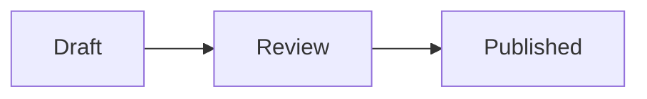

# Mermaid diagrams

## Problem

Technical writers and teams need to keep diagrams beside their workspace content.
A flowchart expressed as text is easy to revise and review, but currently there
is no dedicated Mermaid extension in this repository.

For example, a writer documenting a review process should be able to change
`Draft --> Review --> Published` and immediately see the updated flowchart without
leaving Lunaris or sending the source to a rendering service.

## Proposed experience

Create a Mermaid diagram resource, open its resource view, and edit the source
beside a live preview. New resources start with a small flowchart:

Copy the source or download it as a `.mmd` file to reuse elsewhere. If source is
invalid, keep the editor usable, explain the rendering error, and restore the
preview after the source is corrected.

## Minimum scope

- One user-creatable diagram resource type and one editor/preview resource view.
- Editable Mermaid source with a live preview and the initial example above.
- Source persisted in Yjs and synchronized through Lunaris storage.
- Bundled Mermaid renderer and required assets; rendering and editing work
  offline after the extension and resource are available locally.
- Source copy and `.mmd` download, with clear feedback if an operation fails.
- Useful syntax errors that preserve the user's source and allow recovery.
- Keyboard-accessible controls, a labelled preview, and source available as a
  textual representation of the diagram.

## Out of scope

Rich-text embedding, AI generation, drag-and-drop visual editing, PNG/PDF export,
remote rendering services, and changes to the public SDK or core editor.

## Technical fit

- **Resource type / resource view:** define an extension-owned diagram resource
  type and matching editor/preview resource view using the public SDK. Use the
  [current starter](../create-extension/README.md) and
  [quickstart](https://docs.lunaris.app/developers/extensions/quickstart).
- **Storage:** propose a named `content` Yjs slot containing diagram source as
  collaborative text. The resource type owns storage; the resource view declares
  its requirements. Verify binding, initialization, and concurrent-edit behavior
  against the current SDK before implementation.
- **Permissions:** rendering must need no external network access. Confirm current
  host/browser capabilities for source copy and download; report missing support
  in the discussion before expanding scope or adding permissions.
- **Dependencies:** bundle Mermaid and assets needed by supported diagrams. Review
  its version, license, bundle size, and sandbox compatibility when choosing the
  dependency. Avoid remote fonts, scripts, or diagram services.
- **Safe rendering:** treat source and generated markup as untrusted. Use Mermaid's
  restrictive rendering configuration, disable executable content and external
  interactions, and verify hostile labels/links cannot execute scripts or trigger
  network requests. The iframe sandbox is an additional boundary.
- **SDK gaps:** investigate public registration, Yjs handles, clipboard/download,
  and renderer compatibility first. Record blockers in the linked issue and agree
  a revised scope with maintainers; this brief does not promise unavailable APIs.

## Acceptance criteria

- [ ] Creating a diagram opens a resource view with the example flowchart.
- [ ] Editing valid source updates the preview without a manual save or reload.
- [ ] Closing and reopening preserves source; two clients converge after synced
      edits, including edits made while disconnected.
- [ ] With extension and resource cached, editing and rendering work offline and
      do not request remote rendering, fonts, scripts, or assets.
- [ ] Invalid source shows an understandable error, preserves all source text,
      and renders again after correction.
- [ ] Copy and `.mmd` download reproduce the current source; failures are visible.
- [ ] Editor and controls work using only a keyboard, focus remains visible, and
      the preview has an accessible name with source available to assistive tools.
- [ ] Untrusted labels, markup, and links cannot execute scripts or initiate
      external requests; stale render results cannot overwrite newer previews.
- [ ] Tests cover source persistence, preview updates/error recovery, and safe
      rendering. Contributor documentation explains setup and known limitations.

## Contribution

- **Status:** Open
- **Estimated effort:** Medium — resource registration, collaborative text binding,
  renderer integration, and accessibility/security checks; subject to SDK review.
- **Discussion / claim issue:** Not opened
- **Contributor:** Unassigned; maintainer confirmation required
- **Implementation PR:** Not opened

Follow the [contribution workflow](README.md#take-on-a-request). Keep the overview
and this brief in sync when claiming or completing work.
